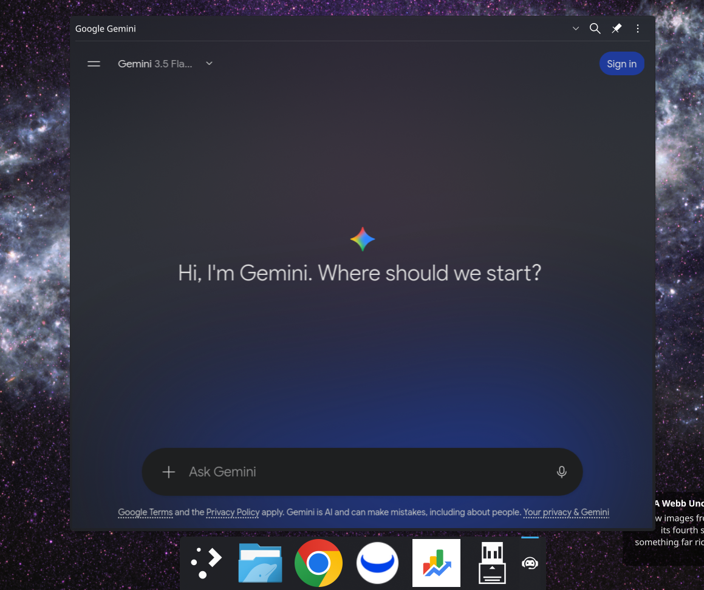

# Prajna

*Prajñā* (प्रज्ञा) — Sanskrit for wisdom, insight.

Your AI chats in a light **glass popup** on the KDE Plasma panel: ChatGPT,
Claude, Gemini, Copilot, Perplexity, DeepSeek, Grok and more, or any site you
add.



- **Glass look**: the site's own background disappears and the chat floats
  on the blurred desktop, under a veil in your theme's colour (adjustable),
  with an optional fine grain. Messages, menus and the text box keep their
  colours.
- **Tabs**: Ctrl+T, Ctrl+W, Ctrl+Tab; links can open in a new tab or in your
  browser; the open tabs come back after a restart (each loads when you
  open it, so a big session doesn't slow down the start).
- **Light on resources**: no Chromium inside Plasma (see below); the engine
  is paused while the popup is closed and stopped after a while, releasing
  all its memory; pages are drawn on the integrated GPU.
- Find in page, downloads, file uploads, notifications, microphone/camera
  permissions (you choose), clipboard with images, sign-in popups,
  HiDPI, input methods.

Prajna started as a fork of
[ChatAI-Plasmoid](https://github.com/DenysMb/ChatAI-Plasmoid) by Denys
Madureira and Bruno Gonçalves, and has since been rewritten around its own
web engine.

## Install

**Ready-made package (Arch-based systems):** download `prajna.plasmoid` from
the [Releases](https://github.com/postadelmaga/prajna/releases) (or the latest
[build](https://github.com/postadelmaga/prajna/actions)), then:

```sh
sudo pacman -S --needed wpewebkit      # the engine's runtime dependency
kpackagetool6 -t Plasma/Applet -i prajna.plasmoid    # -u to upgrade
systemctl --user restart plasma-plasmashell
```

The package contains compiled parts built on Arch Linux: on other
distributions build from source.

**From source.** Requirements: Plasma 6, Qt ≥ 6.6, KDE Frameworks/ECM 6, `wpewebkit` ≥ 2.48
(with the WPE Platform API), `libxkbcommon`, CMake and a C/C++ compiler.

```sh
# Arch / CachyOS / Manjaro
sudo pacman -S --needed wpewebkit extra-cmake-modules cmake base-devel

git clone https://github.com/postadelmaga/prajna.git
cd prajna
./install.sh                 # per user, into ~/.local (no root needed)
# or build, test and pack prajna.plasmoid:
./build.sh
# or system-wide:
cmake -B build -DCMAKE_INSTALL_PREFIX=/usr && cmake --build build && sudo cmake --install build
```

Then right-click the panel → *Add or Manage Widgets…* → **Prajna**.
After an upgrade, restart Plasma: `systemctl --user restart plasma-plasmashell`.

The engine and the QML plugin are installed **inside** the plasmoid package
(`contents/lib/prajna/`), so no QML import path setup is needed. Prajna has
compiled parts, so it is not installable from *Get New Widgets* alone.

## Using it

Click the panel icon (or give it a shortcut in the widget settings) and pick
a site in the top bar. Log in as usual: cookies stay in the widget's profile.

| Keys | Action |
|---|---|
| Ctrl+T | New tab with the start page |
| Ctrl+W | Close the tab |
| Ctrl+Tab / Ctrl+Shift+Tab, Ctrl+PgDown / Ctrl+PgUp | Next / previous tab |
| Ctrl+F | Find in page |

Middle-click closes a tab; the right-click menu has *Open Link in New Tab*.
Right-clicking the panel icon offers *Go to Start Page*, *Reload Page* and
*Keep Open* even when the top bar is hidden.

## Settings

- **Sites**: start page, which sites appear in the top bar, your own sites,
  where links to new windows open (new tab or web browser), reopening the
  tabs of the last session.
- **Appearance**: transparent page background, blur, the veil (how much of
  the theme colour covers the desktop) and grain; panel icon; top bar
  (always, on hover at the top edge, never) and its buttons.
- **Privacy**: what websites may do (notifications, microphone, camera,
  screen, location, clipboard, windows, autoplay), downloads folder, profile
  name — give each widget its own profile to keep separate accounts.
- **Engine**: load at login, free memory after N minutes closed, integrated
  GPU or CPU, frame rate, low-memory JavaScript, memory limit, user agent,
  spatial navigation.

## Coming from ChatAI-Plasmoid

Prajna installs as a new widget (`io.github.postadelmaga.prajna`). To keep an
existing ChatAI-Plasmoid widget with its settings and logins:

```sh
systemctl --user stop plasma-plasmashell
sed -i 's/^plugin=ChatAI-Plasmoid$/plugin=io.github.postadelmaga.prajna/' \
    ~/.config/plasma-org.kde.plasma.desktop-appletsrc
# only for the WPE edition of ChatAI-Plasmoid (the Qt WebEngine one stored
# its logins elsewhere; just log in again):
mkdir -p ~/.local/share/prajna && mv ~/.local/share/chatai-plasmoid/chat-ai ~/.local/share/prajna/default
systemctl --user start plasma-plasmashell
```

## How it works

Prajna does **not** use Qt WebEngine. Loading Chromium inside
`plasmashell` costs memory even while the popup is closed, and a renderer
crash can take the whole shell down with it. Instead, pages are rendered by a
small **out-of-process WPE WebKit engine** (`prajna-engine`), based on the
Zurf engine protocol (`engine/engine_proto.h`):

```
plasmashell ─ Prajna QML ─ WebSurface (QQuickItem, ~1 MB plugin)
                               │  frames: BGRA slot in shared memory (seqlock)
                               │  control: socketpair (navigate, input, events)
                               ▼
                         prajna-engine  ──  WPE WebKit (integrated GPU or CPU)
```

- Nothing web-related is loaded into Plasma; if the engine crashes it is
  restarted and the panel keeps working.
- While the popup is closed the page is paused, and after a configurable
  time (default 15 min) the engine is stopped and **all** its memory is released.
  Cookies and logins stay on disk (`~/.local/share/prajna/<profile>`).
- WebKit runs as a single web process, without bfcache or WebGL.
- Rendering uses the **integrated** GPU (picked explicitly: the boot VGA /
  Intel device, with `DRI_PRIME` pinned to it). A discrete NVIDIA card is
  never used and stays asleep; nouveau is always skipped. Unchecking
  "Use the integrated GPU" draws with Mesa's software rasterizer instead
  (about twice the memory).
- The see-through page is done inside the engine: a small script, injected
  before the site's own, clears the elements painted with the page's
  background colour and leaves every other surface (messages, menus, the
  text box) as the site draws them.
- Supported: file uploads, downloads, notifications, microphone/camera
  permissions, clipboard both ways (including pasting images), find in page,
  context menu, tabs and login popups (OAuth), HiDPI, IME/dead keys.
- Not supported: printing/saving pages as PDF (WPE has no print backend).

## Troubleshooting

- **No blur**: the *Blur* desktop effect must be on (System Settings →
  Desktop Effects); the Appearance page warns when it is off. Blur only
  applies with the transparent page background.
- **"The web engine could not start"**: check that `wpewebkit` is installed
  and see the log: `journalctl --user -u plasma-plasmashell | grep -i prajna`.
- **Rendering problems on the GPU**: uncheck *Use the integrated GPU*
  (Engine page) to draw on the CPU.
- A site misbehaves with the transparent background: turn it off (Appearance)
  and please open an issue with the site's address.

## Development

```sh
cmake -B build -DBUILD_TESTING=ON && cmake --build build && ctest --test-dir build
```

The test drives the real engine on local pages (typing, input methods,
frames, tabs, engine restarts); no network needed.
`engine/tools/engine_probe.py` drives the engine without Qt (screenshots,
JavaScript, input). `PRAJNA_WEB_ENGINE=/path/to/prajna-engine` makes the
plugin use another engine binary; `PRAJNA_WEB_GPU=1` forces GPU rendering
when running the engine by hand.

## License

Prajna is distributed under the **GNU General Public License v3.0**
([LICENSE](LICENSE)). Source files carry SPDX headers
(`GPL-2.0-only OR GPL-3.0-only OR LicenseRef-KDE-Accepted-GPL`, the usual
KDE terms).

Parts of the code come from ChatAI-Plasmoid, © 2024 Denys Madureira, which
was published under the BSD 3-Clause license; its notice is kept in
[LICENSES/BSD-3-Clause.txt](LICENSES/BSD-3-Clause.txt) as that license
requires.

## Credits

Original ChatAI-Plasmoid authors and contributors:
<!-- readme: contributors -start -->
<table>
	<tbody>
		<tr>
            <td align="center">
                <a href="https://github.com/DenysMb">
                    
                    <br />
                    <sub><b>Denys Madureira</b></sub>
                </a>
            </td>
            <td align="center">
                <a href="https://github.com/bigbruno">
                    
                    <br />
                    <sub><b>Bruno Gonçalves</b></sub>
                </a>
            </td>
            <td align="center">
                <a href="https://github.com/JulWas797">
                    
                    <br />
                    <sub><b>J797</b></sub>
                </a>
            </td>
            <td align="center">
                <a href="https://github.com/meowarex">
                    
                    <br />
                    <sub><b>Meow Meow</b></sub>
                </a>
            </td>
            <td align="center">
                <a href="https://github.com/vitor-dantas">
                    
                    <br />
                    <sub><b>Vitor Dantas</b></sub>
                </a>
            </td>
            <td align="center">
                <a href="https://github.com/postadelmaga">
                    
                    <br />
                    <sub><b>postadelmaga</b></sub>
                </a>
            </td>
		</tr>
	<tbody>
</table>
<!-- readme: contributors -end -->

Colorful ChatGPT icon by [IconScout](https://iconscout.com/)

All other chat icons by [Icons8](https://icons8.com/)
